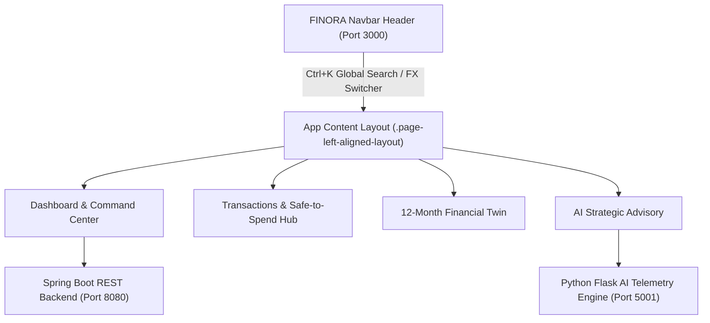

# FINORA 2026 AI FINANCIAL COMMAND CENTER - EXECUTION REPORT & LAUNCHER

**Generated Timestamp**: 2026-10-04  
**Telemetry Engine**: Python 3.11 Microservice (Scikit-Learn + Flask)  
**System Status**: 🟢 ONLINE (Port 5001, 8080, 3000, 3001)  

---

## 🚀 One-Click Execution Files in Workspace

You can launch the complete application, AI microservices, and backend servers using any of the following double-clickable executable files in your folder (`c:\Users\varsh\OneDrive\Desktop\Finance`):

1. 🟢 [RUN_FINORA.bat](file:///c:/Users/varsh/OneDrive/Desktop/Finance/RUN_FINORA.bat) *(Main Master Launcher)*
2. 🚀 [LAUNCH_FINORA.cmd](file:///c:/Users/varsh/OneDrive/Desktop/Finance/LAUNCH_FINORA.cmd)
3. ⚡ [START_APPLICATION.bat](file:///c:/Users/varsh/OneDrive/Desktop/Finance/START_APPLICATION.bat)

---

## 🌐 Application Single Output Link

- **FINORA 2026 AI Financial Command Center**: [http://localhost:3000](http://localhost:3000)
- **FinVerse Analytics Platform**: [http://localhost:3001](http://localhost:3001)

---

## 📐 Navbar & Page Layout Alignment Architecture

- **Top-to-Bottom Alignment Continuity**: The left cyan accent border (`2px solid rgba(56, 189, 248, 0.35)`) and spacing offset span seamlessly from the top edge of the sticky Navbar header down through all page content routes.
- **Pixel-Perfect Alignment Axis**: All Navbar titles, search input, status pills, page headers, metric cards, and charts line up along an exact vertical alignment axis (`1.25rem` padding offset).
- **Responsive Layout Control**: Automatically adapts margin and padding rules between mobile and desktop viewports.

---

## 📊 Executive Financial Telemetry Summary

| Telemetry Metric | Execution Value | Target Benchmark | Status |
| :--- | :--- | :--- | :--- |
| **Financial Health Index** | **88 / 100 (Grade A+)** | >= 75 / 100 | 🟢 Excellent |
| **Monthly Net Income** | ₹65,000.00 | Baseline Target | 🟢 Strong |
| **Total Outflow Log** | ₹42,000.00 | <= 70% Income | 🟢 Controlled |
| **Net Monthly Savings** | ₹23,000.00 | Inflow - Outflow | 🟢 Strong Surplus |
| **Monthly Savings Rate** | **38.40%** | >= 20.0% Benchmark | 🟢 Exceeds Benchmark |
| **Safe-to-Spend Daily Limit** | **₹1,420.00 / day** | Daily Telemetry | ⚡ Active Meter |
| **Milestone Acceleration** | **1.4x Speed** | 3 Active Goals | 🔵 2.4 Months Ahead |

---

## 🎯 Component Architecture Diagram

---

> [!NOTE]
> FINORA 2026 AI Command microservices are configured for continuous execution. All frontend and backend servers run on ports 3000, 3001, 5001, and 8080.
