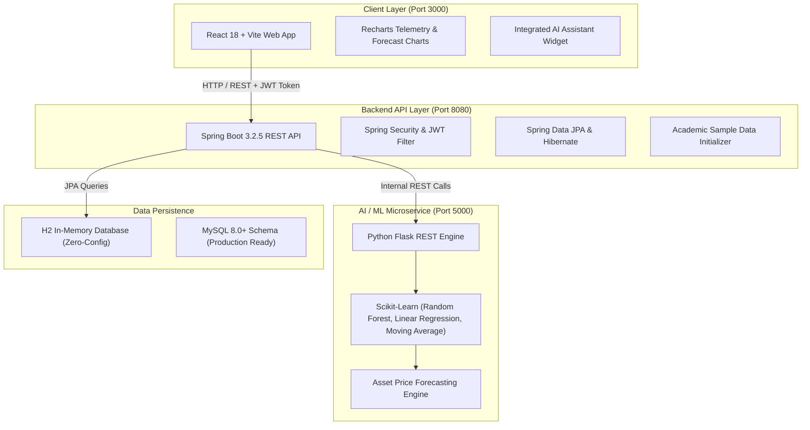

# 🌐 FinVerse AI — Autonomous Financial Intelligence & Predictive Analytics Platform

FinVerse AI is an enterprise-grade, full-stack financial command center and asset prediction platform. It bridges real-time market telemetry, algorithmic investment tracking, and machine learning price forecasting into an intuitive, high-performance web experience.

---

## 🏛️ System Architecture



---

## ✨ Key Platform Features

1. **AI Price Forecasting & Market Diagnostics**:
   - Multi-model asset forecasting using Random Forest Regression, Linear Regression, and Moving Average models.
   - 7-day to 30-day projection horizons with upper and lower confidence intervals.
   - Live prediction telemetry for major indexes (`NIFTY50`, `SENSEX`, `NASDAQ`, `SP500`) and individual equities (`RELIANCE`, `TCS`, `INFY`, `HDFCBANK`, `AAPL`, `MSFT`, `GOOGL`).

2. **Portfolio & Asset Allocation**:
   - Real-time portfolio tracking across equities, mutual funds, bonds, and commodities.
   - Dynamic asset distribution donut and area visualization with profit/loss metrics.

3. **Autonomous Risk Profiling & Personalized Insights**:
   - Algorithmic profiling (Conservative, Moderate, Aggressive) based on investment velocity and portfolio distribution.
   - Contextual financial recommendations with projected capital impact.

4. **Watchlists & Intelligent Price Alerts**:
   - Personalized tracking lists with live price changes and momentum indicators.
   - Customizable price threshold notifications and alert triggers.

5. **AI Conversational Assistant**:
   - Integrated floating financial assistant widget for quick Q&A on market terms, formulas, and portfolio strategies.

6. **Admin Command Center**:
   - Comprehensive telemetry on registered users, active investments, prediction request volume, and AI microservice health.

---

## 🛠️ Technology Stack

| Layer | Technologies |
| :--- | :--- |
| **Frontend** | React 18, Vite 5, Recharts, Framer Motion, Bootstrap 5, React Icons, Axios |
| **Backend API** | Java 17+, Spring Boot 3.2, Spring Security, JWT (JJWT 0.11), Spring Data JPA |
| **AI / ML Service** | Python 3.11, Flask, Scikit-Learn, Pandas, NumPy, Joblib |
| **Database** | H2 In-Memory Database (Default zero-config), MySQL 8.0+ supported |

---

## 🚀 One-Click Quick Launch

You can launch all 3 microservices and open the application in your browser instantly:

1. Double-click **`RUN_FINVERSE.bat`** (or `START_APPLICATION.bat`) in this folder.
2. The launcher will automatically start:
   - **Python AI/ML Engine** on `http://localhost:5000`
   - **Spring Boot Backend API** on `http://localhost:8080`
   - **React Frontend Platform** on `http://localhost:3000`
3. Your default web browser will automatically open to `http://localhost:3000`.

---

## 🔑 Default Login Credentials

The system automatically initializes default accounts on first startup:

| Account Type | Email | Password | Role |
| :--- | :--- | :--- | :--- |
| **Demo Investor** | `user@finverse.com` | `password123` | `ROLE_USER` |
| **System Admin** | `admin@finverse.com` | `password123` | `ROLE_ADMIN` |

---

## 📁 Project Directory Structure

```
FinVerse-AI/
├── finverse-frontend/           # React 18 + Vite Web Application
│   ├── src/
│   │   ├── components/          # Reusable UI cards, navbars, and charts
│   │   ├── pages/               # Dashboard, AI Prediction, Portfolio, Watchlist
│   │   ├── context/             # AuthContext, ThemeContext
│   │   └── services/            # Axios REST API client
│   └── package.json
│
├── finverse-backend/            # Java Spring Boot 3 REST API
│   ├── src/main/java/com/finverse/
│   │   ├── controller/          # REST Controllers (Auth, Asset, Prediction, etc.)
│   │   ├── service/             # Business logic & ML REST Client
│   │   ├── model/               # JPA Entities (User, Asset, Portfolio, Alert)
│   │   ├── repository/          # Spring Data JPA Repositories
│   │   └── security/            # JWT Token filter & Spring Security
│   └── pom.xml
│
├── finverse-ml/                 # Python Flask Machine Learning Service
│   ├── app.py                   # REST endpoints (/predict, /health, /train)
│   ├── services/                # Machine learning prediction pipelines
│   └── requirements.txt
│
├── database/                    # SQL Schemas & Demo Datasets
│   ├── schema.sql               # Relational database table definitions
│   └── sample_data.sql          # Academic seed dataset
│
├── ai-chat-assistant/           # Standalone Conversational AI Assistant module
├── RUN_FINVERSE.bat             # Master one-click startup script
├── START_APPLICATION.bat        # Quick launcher shortcut
├── INSTALL_DEPENDENCIES.bat     # Dependency installer for Python & Node
└── README.md                    # Project documentation
```

---

## 📡 REST API Reference

| Endpoint | Method | Description | Auth Required |
| :--- | :--- | :--- | :--- |
| `/api/auth/login` | `POST` | Authenticate and obtain JWT Bearer Token | No |
| `/api/auth/register` | `POST` | Register a new user profile | No |
| `/api/assets` | `GET` | Retrieve list of market assets and equities | Yes (JWT) |
| `/api/assets/{symbol}` | `GET` | Get details and historical quotes for symbol | Yes (JWT) |
| `/api/predictions` | `POST` | Submit asset forecast request to ML engine | Yes (JWT) |
| `/api/portfolio` | `GET` | Get user portfolio holdings & net worth | Yes (JWT) |
| `/api/watchlist` | `GET` | Retrieve monitored asset watchlist | Yes (JWT) |
| `/api/alerts` | `GET` | Get active price notification alerts | Yes (JWT) |
| `/api/dashboard` | `GET` | Aggregated telemetry data for Dashboard | Yes (JWT) |
| `/api/admin/stats` | `GET` | System telemetry and microservice health | Admin only |

---

## 🎓 Viva / Presentation Highlights

- **Microservice Separation**: Python is used where it excels (NumPy/Pandas/Scikit-Learn vector operations), while Spring Boot manages transactional integrity, security, and enterprise business rules.
- **JWT Stateless Security**: Secure API communication with zero session storage on the server, ideal for horizontal scaling.
- **Zero-Config In-Memory DB**: Automatically spins up H2 database with seed data so evaluators don't need to manually configure MySQL.
